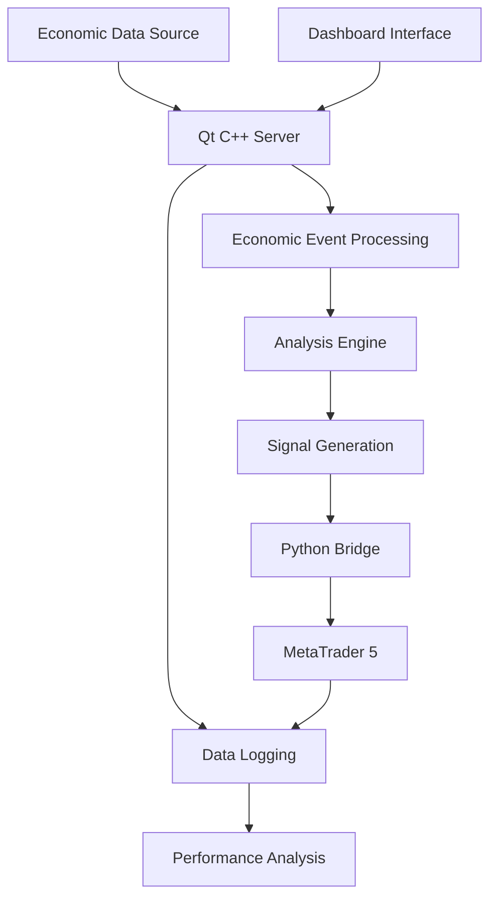

# Automated Economic Event Analysis System

An independent software development project exploring economic data processing, automated analysis, and financial technology.

## Overview

The Automated Economic Event Analysis System is designed to process economic announcements, analyse differences between forecasted and actual results, and generate structured trading signals.

The project combines C++, Qt, and Python to explore software automation, data analysis, and communication between independent applications.

## Objectives

- Process economic-event data.
- Analyse economic surprises using forecast and actual values.
- Develop a rule-based signal generation framework.
- Establish communication between a C++ server and Python bridge.
- Explore integration with MetaTrader 5.
- Implement data logging and performance analysis.
- Investigate software reliability and risk-management principles.

## Technologies

- C++
- Qt Framework
- Python
- JSON
- MetaTrader 5
- SQLite (planned)
- Git

## System Architecture

The system is designed around several independent modules:

1. **Economic Data Processing** — receives and organizes economic-event information.
2. **Analysis Engine** — evaluates economic data and calculates forecast-versus-actual differences.
3. **Signal Generation** — produces structured analytical signals.
4. **C++ Server** — coordinates processing and communication between modules.
5. **Python Bridge** — facilitates communication with MetaTrader 5.
6. **Data Logging** — records system activity for analysis and evaluation.

## Development Status

This project is currently under development.

Initial development has focused on establishing the Qt server, networking infrastructure, Python integration, and structured communication between components.

Additional analytical, data-processing, testing, and reporting capabilities are being developed.

## Learning Goals

Through this project, I aim to develop practical experience in:

- Software engineering
- Network programming
- Cross-language integration
- Data analysis
- System architecture
- Debugging
- Automation
- Computational problem-solving

## Future Development

- Economic data source integration
- Improved event analysis
- Historical simulation
- Testing framework
- Database integration
- Performance reporting
- System visualization
- Improved error handling

## Author

**Ayabongwa Cele**

Independent software development project exploring computer science, automation, mathematics, and financial technology.

## System Architecture

## Project Documentation

Detailed documentation is available below:

- [System Architecture](docs/system_architecture.md) — Overview of the system structure and component interactions.
- [Development Log](docs/development_log.md) — Development progress, challenges, and lessons learned.
- [Project Roadmap](docs/roadmap.md) — Current milestones and planned improvements.
- [Testing Documentation](docs/testing.md) — Testing approach, integration checks, and known limitations.
- [Project Summary](docs/project_summary.md) — Project motivation, technical approach, and learning outcomes.

## Current Status

The project is an integrated prototype currently undergoing further development. The core components have been connected, and the system can execute and produce output.

Future development focuses on improving automated data processing, analytical functionality, testing, and system monitoring.

## System Demonstration

The following screenshot shows the integrated system executing and producing output.

.png>)
